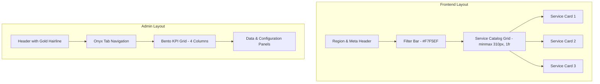

# NexPort Bridge — Design System & Color Theme Specification

**Theme Concept:** *Executive Warm White Luxury*  
**Platform:** WordPress Integration Connector for Dhru Fusion  
**Scope:** Frontend Public UI (`public/css/public.css`) & Administrator Dashboard (`admin/css/admin.css`)

---

## 1. Executive Overview

The NexPort Bridge visual language is engineered around an **Executive Warm White Luxury** aesthetic. Moving away from stark clinical whites and generic dark modes, it utilizes a warm alabaster and crisp bone canvas paired with deep stone onyx, champagne/antique gold accents, and subtle ambient shadows. 

This palette conveys prestige, reliability, and precision, reflecting the high-value transactions and automated unlocking operations handled by Dhru Fusion.

---

## 2. Master Color Tokens

### 2.1 Canvas & Surfaces

| Token (Public) | Token (Admin) | HEX | RGB | HSL | Semantic Role |
| :--- | :--- | :--- | :--- | :--- | :--- |
| `--nexport-bg-canvas` | `--np-bg-canvas` | `#FAF8F5` | `250, 248, 245` | `36°, 33%, 97%` | Outer page backdrop / canvas |
| `--nexport-surface` | `--np-bg-surface` | `#FFFFFF` | `255, 255, 255` | `0°, 0%, 100%` | Cards, panels, modal dialogs, tables |
| `--nexport-surface-subtle` | `--np-bg-subtle` | `#F7F5EF` | `247, 245, 239` | `45°, 29%, 95%` | Filter toolbars, input backgrounds, meta panels |
| `--nexport-surface-muted` | `--np-bg-muted` | `#EFEAE1` | `239, 234, 225` | `39°, 32%, 91%` | Inactive tabs, disabled states, subtle wells |
| `--nexport-surface-hover` | `--np-bg-hover` | `#F9F7F2` | `249, 247, 242` | `43°, 37%, 96%` | Table row hover, list item hover |
| — | `--np-bg-active` | `#F3EFE6` | `243, 239, 230` | `42°, 33%, 93%` | Active / pressed background |

---

### 2.2 Borders & Dividers

| Token (Public) | Token (Admin) | HEX | RGB | HSL | Semantic Role |
| :--- | :--- | :--- | :--- | :--- | :--- |
| `--nexport-border-warm` | `--np-border-warm` | `#E6E0D4` | `230, 224, 212` | `40°, 27%, 87%` | Standard card, table & field borders |
| `--nexport-border-subtle` | `--np-border-subtle` | `#F0EBE2` | `240, 235, 226` | `39°, 30%, 91%` | Internal row dividers, tag borders |
| `--nexport-border-hover` | `--np-border-hover` | `#D5CDBD` | `213, 205, 189` | `40°, 22%, 79%` | Interactive hover borders |
| `--nexport-border-gold` | `--np-border-gold` | `#C59752` | `197, 151, 82` | `36°, 51%, 55%` | Champagne gold hairline accents & dividers |

---

### 2.3 Typography & Text Hierarchy

| Token (Public) | Token (Admin) | HEX | RGB | HSL | Semantic Role |
| :--- | :--- | :--- | :--- | :--- | :--- |
| `--nexport-text-primary` | `--np-text-primary` | `#1C1917` | `28, 25, 23` | `24°, 10%, 10%` | Primary headings, titles, active labels (Stone 900) |
| `--nexport-text-secondary` | `--np-text-secondary` | `#57534E` | `87, 83, 78` | `33°, 5%, 32%` | Body paragraphs, descriptions, subtitles (Stone 600) |
| `--nexport-text-muted` | `--np-text-muted` | `#78716C` | `120, 113, 108` | `25°, 5%, 45%` | Timestamps, table column headers, helper notes |
| `--nexport-text-light` | `--np-text-light` | `#A8A29E` | `168, 162, 158` | `24°, 6%, 64%` | Placeholder text, secondary icons (Stone 400) |

---

### 2.4 Luxury Champagne & Antique Gold Accents

| Token (Public) | Token (Admin) | HEX | RGB | HSL | Semantic Role |
| :--- | :--- | :--- | :--- | :--- | :--- |
| `--nexport-accent-gold` | `--np-accent-gold` | `#B47B2B` | `180, 123, 43` | `35°, 61%, 44%` | Primary champagne gold accent, icons, focus rings |
| `--nexport-accent-gold-dark` | `--np-accent-gold-dark` | `#926024` | `146, 96, 36` | `33°, 60%, 36%` | Text on light gold badges, active hover states |
| `--nexport-accent-gold-light` | `--np-accent-gold-light` | `#FEF9EE` | `254, 249, 238` | `41°, 89%, 96%` | Badge background tint, active pill backgrounds |
| `--nexport-accent-gold-border`| `--np-accent-gold-border`| `#F1DDBC` | `241, 221, 188` | `37°, 64%, 84%` | Light gold badge borders |
| — | *Metallic Gold* | `#E5B36A` | `229, 179, 106` | `36°, 71%, 66%` | Header emblem icon & high-contrast logo accents |

---

### 2.5 Onyx Neutrals (Primary Action Buttons)

| Token (Public) | Token (Admin) | HEX | RGB | HSL | Semantic Role |
| :--- | :--- | :--- | :--- | :--- | :--- |
| `--nexport-onyx` | `--np-onyx` | `#1C1917` | `28, 25, 23` | `24°, 10%, 10%` | Primary buttons, active navigation pills |
| `--nexport-onyx-hover` | `--np-onyx-hover` | `#292524` | `41, 37, 36` | `12°, 6%, 15%` | Primary button hover / focus |
| — | `--np-onyx-active` | `#0C0A09` | `12, 10, 9` | `20°, 14%, 4%` | Button active / pressed state |

---

### 2.6 Truthful Availability & Semantic States

#### A. Available (Active / Connected / Healthy)
- **Text:** `#166534` (`rgb(22, 101, 52)`)
- **Background:** `#F0FDF4` (`rgb(240, 253, 244)`)
- **Border:** `#BBF7D0` (`rgb(187, 247, 208)`)
- **Indicator Dot:** `#22C55E` (`rgb(34, 197, 94)`) + `box-shadow: 0 0 0 2px rgba(34, 197, 94, 0.25)`

#### B. Temporarily Unavailable (Degraded / Supplier Maintenance)
- **Text:** `#92400E` (`rgb(146, 64, 14)`)
- **Background:** `#FFFBEB` (`rgb(255, 251, 235)`)
- **Border:** `#FDE68A` (`rgb(253, 230, 138)`)
- **Indicator Dot:** `#F59E0B` (`rgb(245, 158, 11)`)

#### C. Offline / API Connection Error (Outage / Unreachable)
- **Text:** `#991B1B` (`rgb(153, 27, 27)`)
- **Background:** `#FEF2F2` (`rgb(254, 242, 242)`)
- **Border:** `#FECACA` (`rgb(254, 202, 202)`)
- **Indicator Dot:** `#EF4444` (`rgb(239, 68, 68)`)

#### D. Informational Notice (Audit / Sync / Diagnostics)
- **Text:** `#1E40AF` (`rgb(30, 64, 175)`)
- **Background:** `#EFF6FF` (`rgb(239, 246, 255)`)
- **Border:** `#BFDBFE` (`rgb(191, 219, 254)`)
- **Indicator Dot:** `#3B82F6` (`rgb(59, 130, 246)`)

#### E. Unknown / Unverified
- **Text:** `#57534E` (`rgb(87, 83, 78)`)
- **Background:** `#F7F5EF` (`rgb(247, 245, 239)`)
- **Border:** `#E6E0D4` (`rgb(230, 224, 212)`)
- **Indicator Dot:** `#A8A29E` (`rgb(168, 162, 158)`)

---

## 3. Elevation, Radii & Shadows

### Corner Radii
```css
--nexport-radius-sm: 6px;   /* Small pills, micro badges, type tags */
--nexport-radius-md: 10px;  /* Buttons, form inputs, table containers */
--nexport-radius-lg: 14px;  /* Service cards, status boards, bento boxes */
--nexport-radius-xl: 18px;  /* Large modal cards, registration card, header banner */
--nexport-radius-full: 999px; /* Region switchers, status pills */
```

### Box Shadows
```css
/* Ambient soft elevation for cards */
--nexport-shadow-sm: 0 1px 3px rgba(35, 30, 20, 0.04), 0 3px 8px -1px rgba(35, 30, 20, 0.03);
--nexport-shadow-md: 0 2px 6px rgba(35, 30, 20, 0.04), 0 8px 18px -4px rgba(35, 30, 20, 0.04);

/* Hover lift elevation */
--nexport-shadow-hover: 0 6px 16px -2px rgba(35, 30, 20, 0.06), 0 16px 28px -6px rgba(35, 30, 20, 0.08);

/* Onyx button depth */
--nexport-shadow-btn: 0 2px 6px rgba(28, 25, 23, 0.20);
--nexport-shadow-btn-hover: 0 4px 12px rgba(28, 25, 23, 0.28);
```

---

## 4. Typography Scale

```css
--nexport-font-sans: -apple-system, BlinkMacSystemFont, "Segoe UI", Roboto, "Helvetica Neue", Arial, sans-serif;
--nexport-font-mono: ui-monospace, SFMono-Regular, Menlo, Monaco, Consolas, monospace;
```

| Element | Size | Weight | Line Height | Tracking | Color |
| :--- | :--- | :--- | :--- | :--- | :--- |
| **Page Title** | `24px` | `800` (Bold) | `1.2` | `-0.025em` | `#1C1917` |
| **Card / Section Title** | `21px` / `18px` | `700` | `1.3` | `-0.015em` | `#1C1917` |
| **Service Title** | `17px` | `700` | `1.35` | `-0.01em` | `#1C1917` |
| **Body / Description** | `14px` / `13px` | `400` / `500` | `1.55` | `normal` | `#57534E` |
| **Table Headers** | `11px` | `700` | `1.2` | `+0.05em` (Caps) | `#78716C` |
| **Micro-Badges** | `11px` / `12px` | `600` | `1.0` | `+0.03em` | Varies |

---

## 5. UI Component Specifications

### 5.1 Primary Onyx Button
```css
.nexport-btn--primary {
    background-color: #1c1917;
    color: #ffffff !important;
    border: 1px solid #1c1917;
    border-radius: 10px;
    padding: 10px 20px;
    font-size: 14px;
    font-weight: 600;
    box-shadow: 0 2px 6px rgba(28, 25, 23, 0.2);
    transition: all 0.18s ease;
}
.nexport-btn--primary:hover {
    background-color: #292524;
    border-color: #292524;
    transform: translateY(-1px);
    box-shadow: 0 4px 12px rgba(28, 25, 23, 0.28);
}
```

### 5.2 Secondary Gold Gradient Button
```css
.nexport-btn--secondary {
    background: linear-gradient(135deg, #a16207 0%, #b47b2b 100%);
    color: #ffffff !important;
    border: 1px solid #8c5d1e;
    border-radius: 10px;
    box-shadow: 0 2px 6px rgba(180, 123, 43, 0.25);
}
.nexport-btn--secondary:hover {
    background: linear-gradient(135deg, #8c5304 0%, #a16207 100%);
    box-shadow: 0 4px 12px rgba(180, 123, 43, 0.35);
}
```

### 5.3 Status Indicator Pill (Live Available)
```css
.nexport-status-pill {
    display: inline-flex;
    align-items: center;
    gap: 7px;
    padding: 4px 11px;
    border-radius: 999px;
    font-size: 11px;
    font-weight: 600;
    background: #f0fdf4;
    color: #166534;
    border: 1px solid #bbf7d0;
}
.nexport-status-pill__dot {
    width: 7px;
    height: 7px;
    border-radius: 50%;
    background: #22c55e;
    box-shadow: 0 0 0 2px rgba(34, 197, 94, 0.25);
}
```

### 5.4 Region Switcher Pill Wrapper
```css
.nexport-region-switcher {
    display: inline-flex;
    gap: 6px;
    background: #f7f5ef;
    padding: 5px;
    border-radius: 999px;
    border: 1px solid #e6e0d4;
    box-shadow: inset 0 1px 2px rgba(35, 30, 20, 0.04);
}
.nexport-region-btn.is-active {
    background: #ffffff;
    color: #1c1917;
    border-color: #e6e0d4;
    box-shadow: 0 1px 3px rgba(35, 30, 20, 0.04);
}
```

---

## 6. Layout Grid Specs



- **Service Catalog Grid:** `grid-template-columns: repeat(auto-fill, minmax(310px, 1fr)); gap: 22px;`
- **Admin Bento Grid:** `grid-template-columns: repeat(4, minmax(0, 1fr)); gap: 16px;`
- **Two-Column Form Row:** `grid-template-columns: repeat(2, minmax(0, 1fr)); gap: 16px;`
- **Mobile Breakpoint (`max-width: 768px`):** All multi-column grids collapse to `grid-template-columns: 1fr`.

---

## 7. Tailwind CSS Configuration (Compatibility)

For external pages, custom themes, or headless frontends integrating with NexPort Bridge:

```javascript
// tailwind.config.js
module.exports = {
  theme: {
    extend: {
      colors: {
        nexport: {
          canvas: '#faf8f5',
          surface: {
            DEFAULT: '#ffffff',
            subtle: '#f7f5ef',
            muted: '#efeae1',
            hover: '#f9f7f2',
            active: '#f3efe6',
          },
          border: {
            warm: '#e6e0d4',
            subtle: '#f0ebe2',
            hover: '#d5cdbd',
            gold: '#c59752',
          },
          onyx: {
            DEFAULT: '#1c1917',
            hover: '#292524',
            active: '#0c0a09',
          },
          gold: {
            DEFAULT: '#b47b2b',
            dark: '#926024',
            light: '#fef9ee',
            border: '#f1ddbc',
            metallic: '#e5b36a',
          },
          status: {
            available: {
              text: '#166534',
              bg: '#f0fdf4',
              border: '#bbf7d0',
              dot: '#22c55e',
            },
            unavailable: {
              text: '#92400e',
              bg: '#fffbeb',
              border: '#fde68a',
              dot: '#f59e0b',
            },
            offline: {
              text: '#991b1b',
              bg: '#fef2f2',
              border: '#fecaca',
              dot: '#ef4444',
            },
            info: {
              text: '#1e40af',
              bg: '#eff6ff',
              border: '#bfdbfe',
              dot: '#3b82f6',
            },
          },
        },
      },
      borderRadius: {
        'np-sm': '6px',
        'np-md': '10px',
        'np-lg': '14px',
        'np-xl': '18px',
      },
    },
  },
};
```

---

## 8. WCAG Accessibility & Contrast Compliance

- **Primary Onyx on Warm Canvas (`#1C1917` on `#FAF8F5`)**: Contrast ratio **14.8:1** (Exceeds WCAG AAA requirement of 7:1).
- **Secondary Stone on White (`#57534E` on `#FFFFFF`)**: Contrast ratio **7.2:1** (Exceeds WCAG AAA).
- **Dark Gold Text on Light Gold Badge (`#926024` on `#FEF9EE`)**: Contrast ratio **5.1:1** (Exceeds WCAG AA requirement of 4.5:1).
- **White Text on Onyx Button (`#FFFFFF` on `#1C1917`)**: Contrast ratio **15.1:1** (Exceeds WCAG AAA).
- **Available Status Text on Background (`#166534` on `#F0FDF4`)**: Contrast ratio **5.8:1** (Exceeds WCAG AA).
